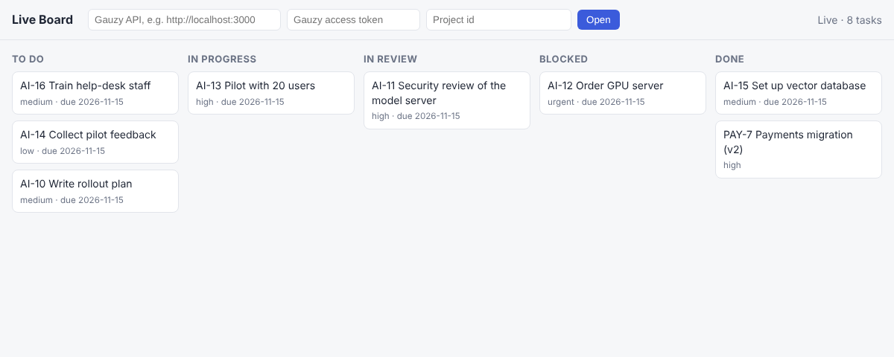
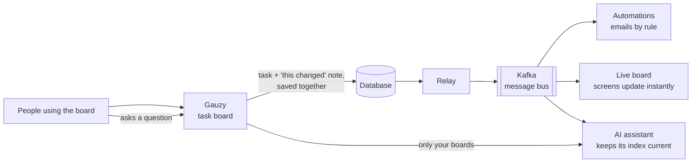

# How it works

## The 30-second version

It's a Monday.com-style task board that runs entirely on the organization's own servers, with
a private AI assistant built in.

The board is Ever Gauzy, an open-source work management app. I added three things to it:

1. **Every change is announced.** When someone edits a task, the app also posts a short
   "this changed" message to a message bus (Kafka).
2. **Other services listen.** One sends automatic emails, for example "your task is done".
   Another updates everyone's screen live. A third keeps the AI assistant's knowledge current.
3. **The assistant only knows what you're allowed to see.** You can ask it "what's blocking
   the launch?" and it answers from the boards you can open, nothing more. No data leaves the
   building.

## The picture

## What each part does

| Part | In one sentence | Why it's there |
|---|---|---|
| Gauzy | The task board people use every day. | A mature open-source app, so I don't rebuild what already exists. |
| Board events plugin | Writes a "this changed" note every time a task changes, at the same moment as the change itself. | If the change is saved, the note is too, so no event is ever lost. If the change fails, there's no note either. |
| Relay | Moves those notes from the database to Kafka. | If Kafka is down, notes wait and go out later. Nothing is dropped. |
| Kafka | The message bus. Every service reads the same stream of changes. | New features plug in without touching the board. The full history can be replayed. |
| Automations | Runs simple rules written as sentences: "when status becomes Done, email the owner". | Teams change rules in one small file. No code. |
| Live board | Pushes changes to open browsers within a second. | Nobody has to refresh. |
| AI assistant | Answers questions about the boards, using a model running on our own GPU. | Useful for managers, with no data sent to an outside AI company. |

## Who sees what

One rule decides it everywhere: **you see the projects you're a member of. Managers see every
project in their organization.** Gauzy checks this rule. The live board and the AI assistant
both ask Gauzy and never decide on their own. A person removed from a project stops seeing it
on their next question to the assistant, and on the live board within 15 minutes at most.

## A demo in five steps

1. Open a project in Gauzy and the live board side by side.
2. Drag a task to *In progress*. The live board moves it within a second.
3. Mark a task *Blocked*. The project manager gets an email. Show it in the mail viewer.
4. Mark it *Done*. The task owner gets a "Done" email.
5. Ask the assistant "What is blocked right now?" It names the task and cites it.

## Decisions I made, and why

- **Build on Gauzy instead of from scratch.** Most of the value is in what sits around the
  board. Reusing a proven app cut scope by months. All my code sits in its own folders, so it's
  clear what I built and what came from Gauzy.
- **The "outbox" pattern instead of sending to Kafka directly.** Sending directly can lose an
  event if Kafka is briefly unavailable. Writing the note together with the change can't.
- **Rules in a file, not a rule-builder screen.** It covers the common cases now, and a screen
  can come later if teams ask for one.
- **Private AI on our own hardware.** It's slower and less capable than a cloud model, but
  nothing leaves the network. For a security-sensitive organization, that's the requirement.

## Known limits (next steps)

- Email is the only automation action so far. Chat messages and webhooks would come next.
- The assistant applies permissions per project, not per task.
- The setup needs Gauzy with PostgreSQL, which is Gauzy's default.
