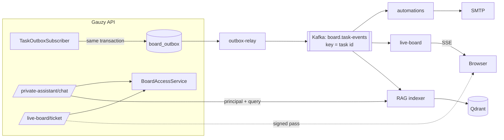

# Task board with Kafka and a private AI assistant

A Monday.com-style board built on [Ever Gauzy](https://github.com/ever-co/ever-gauzy) (AGPL-3.0),
with an event layer on Kafka and the private assistant in `ai-assistant/`.
For the plain-language version, see [HOW-IT-WORKS.md](HOW-IT-WORKS.md).

## Layout

Everything in `task-board/` and `packages/plugins/board-events/` is new code. The rest of this
repository is Ever Gauzy; it only gained the plugin registration (`apps/api/src/plugins.ts`,
`tsconfig.json`, build lists in `package.json`, `.deploy/api/Dockerfile`).

```
task-board/
├── HOW-IT-WORKS.md               plain-language overview and demo script
├── docker-compose.yml            Kafka, relay, automations, live board, mail catcher
├── .env.example
├── ../packages/plugins/board-events/   the Gauzy plugin (already registered in this fork)
│   └── src/lib/
│       ├── outbox/               TaskOutboxSubscriber + event shape (task-event.ts)
│       ├── access/               BoardAccessService: "which projects may this user read"
│       ├── assistant/            POST /api/private-assistant/chat -> RAG service (SSE)
│       ├── live/                 GET /api/live-board/ticket -> 60-second signed pass
│       └── board-events.plugin.ts
├── services/                     one Node image, three entry points
│   ├── src/outbox-relay.js       board_outbox -> Kafka
│   ├── src/automations/          rules.json engine, email via SMTP
│   ├── src/live-board/           server-sent events + demo page
│   ├── rules.json
│   └── test/
└── scripts/live-board-ticket.sh
```

The AI assistant lives in `ai-assistant/`. Its Kafka consumer reads `board.task-events`
directly (`services/rag/app/board_events.py` maps a Gauzy task to an index item).

## Flow



**Event** (`packages/plugins/board-events/src/lib/outbox/task-event.ts`), one per task create, update or delete:

```json
{ "version": 1, "event_id": "uuid", "type": "task.updated", "occurred_at": "...",
  "tenant_id": "...", "organization_id": "...", "project_id": "...", "actor_user_id": "...",
  "task": { "id": "...", "prefix": "PAY", "number": 7, "title": "...", "description": "plain text",
            "status": "done", "priority": "high", "due_date": null, "created_by_user_id": "..." },
  "changes": { "status": { "from": "blocked", "to": "done" } } }
```

`changes` is filled only when the previous row is known (TypeORM `save`, which Gauzy uses for
task updates). Rules fire on real changes only, so re-saving a Done task sends nothing.

**Delivery** is at-least-once. The relay marks rows published only after Kafka acknowledges them.
Automations records each (event, rule) pair in `automation_runs` before sending, and the live
board ignores event ids it has already seen.

**Permissions.** `BoardAccessService` covers organizations the user is an active member of in
their tenant. Users with `CHANGE_SELECTED_EMPLOYEE` (managers, admins) get all projects there.
Everyone else gets projects where they are an active, non-archived member. The results are cached
for 30 seconds. The assistant passes the list to the RAG service, which filters every vector
search by it. The live board accepts only a pass that Gauzy signed for one project
(HMAC-SHA256, `LIVE_BOARD_SECRET`, valid for 60 seconds). Connections are closed after 15 minutes,
so the page has to get a fresh pass.

## Setup

1. **Gauzy with the plugin.** The plugin is already wired into this fork. Build and run Gauzy
   as usual, using its own docs and compose files. Set these in the API's environment:
   - `DB_ORM=typeorm` and `DB_TYPE=postgres`
   - `LIVE_BOARD_SECRET`
   - `RAG_URL=http://rag:8088` and `RAG_SERVICE_TOKEN`

   Then attach the API container to the `app_bridge` network. On first start the plugin creates
   the `board_outbox` table.
2. **Event layer**
   ```bash
   docker network create --internal app_bridge     # once
   cp .env.example .env && $EDITOR .env             # same LIVE_BOARD_SECRET as Gauzy
   docker compose up -d --build
   ```
3. **AI assistant.** Follow `ai-assistant/README.md`, setting `KAFKA_BOOTSTRAP=kafka:9092`.
4. **Open the live board.**
   `GAUZY_TOKEN=... ./scripts/live-board-ticket.sh <project-id>` prints a link. Alternatively, open
   http://localhost:8090 and enter the Gauzy URL, your token and the project id. For the
   in-page option, Gauzy's CORS settings must allow the live board's origin.

## Tests

```bash
cd services && npm install && npm test          # 14 tests: rules, dedupe, relay, live stream
```

The plugin's pure logic (`task-event.spec.ts`, `live-ticket.spec.ts`, 6 tests) runs with Gauzy's
Jest setup: `yarn nx test plugin-board-events`.

### What was verified

- **End to end on 2026-10-08:** PostgreSQL 16, Kafka 3.9.1 and Mailpit, with the three services
  running.
  - Five task changes went through the outbox and were all published. A rolled-back change left
    no event.
  - The status change to Blocked emailed the project manager, and Done emailed the owner. A later
    title edit sent nothing.
  - The live board received each change, rebuilt the board from Kafka after a restart, and
    rejected a tampered pass.
- **Not yet run:** the plugin inside a running Gauzy build, the RAG indexer against a live Qdrant,
  and the Docker image build (Docker Hub rate-limited the base image pull).
