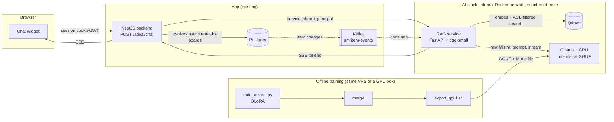

# Self-hosted AI assistant for the PM app

A private assistant that answers questions about boards, items and updates, using a fine-tuned
Mistral-7B served by Ollama on your own GPU VPS. No data goes to any external model provider.

## Architecture



**Indexing path:** an item changes in the app, an event lands on Kafka (or the backend calls
`POST /index`), the RAG service renders it to text, chunks it, embeds it on CPU and upserts it into
Qdrant with `workspace_id` and `board_id` in the payload.

**Query path:** the widget calls `POST /api/ai/chat`. The backend takes the user from the session,
checks board access, looks up every board the user may read, and forwards that "principal" to the
RAG service. The RAG service searches Qdrant only inside those boards, builds a Mistral prompt and
streams Ollama's tokens back as server-sent events.

## File structure

```
ai-assistant/
├── docker-compose.yml            Ollama (GPU) + Qdrant + RAG service on an internal network
├── .env.example                  secrets and tuning knobs
├── services/rag/                 Python RAG service
│   ├── Dockerfile                bakes the embedding model in; runs offline
│   ├── requirements.txt
│   └── app/
│       ├── main.py               /chat (SSE), /search, /index, /healthz
│       ├── config.py             settings from env
│       ├── schemas.py            ItemDoc, ItemEvent, Principal, requests
│       ├── chunking.py           item to text, chunking, stable chunk ids
│       ├── embeddings.py         local sentence-transformers model
│       ├── store.py              Qdrant collection, upsert/delete, ACL-filtered search
│       ├── indexer.py            one event in, chunks indexed
│       ├── consumer.py           optional Kafka consumer
│       ├── prompt.py             Mistral [INST] template + context fencing
│       └── llm.py                streaming client for local Ollama
├── backend-integration/ai/       NestJS module for the existing backend
│   ├── ai.module.ts
│   ├── ai.controller.ts          POST /api/ai/chat, pipes SSE to the browser
│   ├── ai.service.ts             permission lookup + call to RAG service
│   ├── ai-chat.dto.ts            request validation
│   └── board-access.service.ts   "what may this user read" (implemented for Gauzy in packages/plugins/board-events)
└── training/
    ├── train_mistral.py          QLoRA fine-tune (4-bit), then merge to fp16
    ├── export_gguf.sh            HF to GGUF, quantize, `ollama create`
    ├── Modelfile
    ├── requirements.txt
    └── data/pm_train.sample.jsonl
```

## API contract

`POST /api/ai/chat` (app backend, user-facing)

```json
{ "user_id": "u_123", "query": "What's blocking the Q4 launch?", "board_id": "b_42",
  "history": [{ "role": "user", "content": "..." }, { "role": "assistant", "content": "..." }] }
```

`user_id` must equal the signed-in user or the request is rejected with 403. `history` is optional.
The response is `text/event-stream`:

```
event: sources  data: [{"item_id":"i_9","title":"Payments migration","board_id":"b_42"}]
event: token    data: "The launch is blocked by"
event: token    data: " the payments migration [item:i_9]."
event: done     data: {}
```

`POST /chat` on the RAG service is internal only and takes a `principal` built by the backend:
`{ "principal": {"user_id", "workspace_ids", "board_ids"}, "query", "board_id", "history" }`.

Index event (Kafka message value, or a JSON array of these to `POST /index`):

```json
{ "op": "upsert", "doc": { "id": "i_9", "kind": "item", "workspace_id": "w_1", "board_id": "b_42",
  "title": "Payments migration", "body": "...", "status": "Stuck", "columns": {"Owner": "Dana"} } }
{ "op": "delete", "id": "i_9" }
```

## Keeping workspaces and permissions separate

The model never decides who sees what. Permissions are enforced before any text reaches it.

1. **Identity from the session only.** The backend ignores whatever `user_id` the browser claims
   and uses the authenticated user. A mismatch is a 403, not a silent override.
2. **Permission lookup in the app, not the AI stack.** `BoardAccessService.readableScope()` must
   use the same queries as the board UI, so the assistant can never read a board the user could not
   open. The requested `board_id` is checked against that list before anything else happens.
3. **Every vector search is filtered.** Each chunk in Qdrant carries `workspace_id` and `board_id`.
   `store.acl_filter()` adds both as mandatory filters on every query, backed by payload indexes.
   There is no unfiltered search function in the codebase. For hard tenant isolation, switch to one
   Qdrant collection per workspace.
4. **Only AI-visible fields are indexed.** The app sends only columns marked as shareable. Private
   columns (salaries, personal notes) never enter the index, so they cannot leak through retrieval.
5. **Deletes and permission changes propagate.** Deleting an item removes its chunks. Moving an item
   to another board is an upsert with the new `board_id`. Removing someone from a board takes effect
   on their next question, because permissions are looked up per request (cache them for at most
   ~30 seconds).
6. **Prompt injection is contained.** Task text is user-written. `prompt.py` wraps it in `<item>`
   blocks, tells the model to treat it as data, and neutralizes Mistral control tokens such as
   `[INST]` so a task cannot rewrite the prompt. Because retrieval is already permission-filtered,
   a successful injection can only reach data the asking user could see anyway.
7. **The AI stack is unreachable from outside.** Ollama and Qdrant publish no ports and sit on an
   `internal` Docker network with no internet route. The RAG service requires a shared service
   token and is only on a private bridge to the backend. Qdrant has its own API key.
8. **Logs.** Log user id, board id, item ids retrieved and latency. Don't log full prompts or
   answers by default, since they contain board content.

## Running it

```bash
# 1. GPU check on the VPS
nvidia-smi && docker run --rm --gpus all nvidia/cuda:12.4.1-base-ubuntu22.04 nvidia-smi

# 2. Networks and secrets
docker network create --internal app_bridge     # attach the app backend to this network too
cp .env.example .env && $EDITOR .env

# 3. Start the stack (RAG image build needs internet once, to fetch the embedding model)
docker compose up -d --build

# 4. Fine-tune and register the model (needs internet once for the base weights)
cd training && pip install -r requirements.txt
python train_mistral.py --data data/pm_train.jsonl
./export_gguf.sh out/merged Q4_K_M

# 5. Smoke test from inside the app network
curl -N -X POST http://rag:8088/chat -H "Authorization: Bearer $RAG_SERVICE_TOKEN" \
  -H 'Content-Type: application/json' \
  -d '{"principal":{"user_id":"u1","workspace_ids":["w1"],"board_ids":["b1"]},"query":"What is stuck?","board_id":"b1"}'
```

Before fine-tuning, you can test the pipeline with a stock Mistral-7B-Instruct GGUF: download it
on the host, put it in `training/export/`, point the Modelfile's `FROM` at it and run `ollama create`.
`ollama pull` inside the container won't work, because the Ollama container has no internet route by design.

## Sizing

- QLoRA on Mistral-7B fits a single 24 GB GPU at batch size 2 with gradient checkpointing.
- Serving the Q4_K_M GGUF needs about 5 to 6 GB of VRAM, plus KV cache for parallel requests.
- Merging the adapter runs on CPU and needs about 16 GB of RAM.

## Notes and choices

- **Ollama over vLLM** because the training pipeline ends in GGUF. If you expect many concurrent
  users, serve the merged fp16 model with vLLM instead and point `llm.py` at its
  OpenAI-compatible endpoint.
- **Mistral-7B-Instruct v0.3** is the default base. It is gated on Hugging Face, so accept the license
  and download once, then train from a local path.
- **Hebrew content:** `bge-small-en` is English-only. Use `intfloat/multilingual-e5-small`
  (same 384 dimensions) via `EMBEDDING_MODEL`. Its query and passage prefixes are already handled.
- **Training data:** a few hundred to a few thousand high-quality examples beat a large noisy set.
  Keep a held-out eval file and compare against the base model before you switch.
